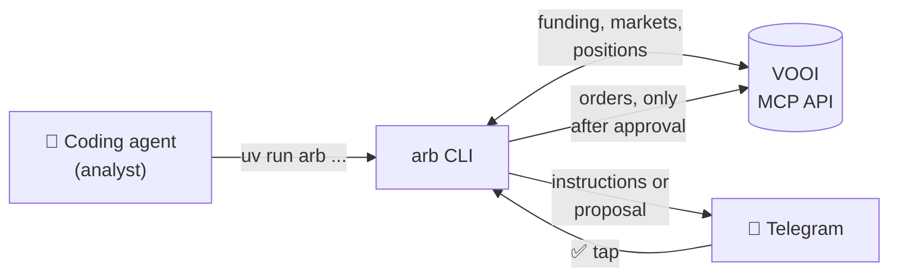

<div align="center">

# vooi-funding-arbitrage

**Delta-neutral funding arbitrage on VOOI, run by the AI coding agent of your choice.**

[](https://github.com/Dado-hash/vooi-funding-arbitrage/actions/workflows/tests.yml)
[](LICENSE)

[](https://docs.astral.sh/uv/)

[Quickstart](#quickstart) · [How it works](#how-it-works) · [Agents](#works-with-any-agent) · [Docs](#documentation)

</div>

> [!WARNING]
> Experimental software, not financial advice. Leveraged perpetual futures can lose all of your capital. Read the code, start with a tiny size, and use it at your own risk.

Go long on one venue and short on another, on the same asset, and collect the funding spread. The hard part is not finding a high APR. It is finding a spread that **lasts long enough to pay for the fees**. A 1000% APR spike that closes in 20 minutes loses money.

This toolkit ranks every pair by **expected net return over your holding horizon**, watches your open positions, and sends you a Telegram message when something needs doing.

## Features

- 🔎 **Whole-universe scan.** Hourly funding history for every market, so persistence is scored on all pairs, not only today's spikes.
- 📈 **Return you can trust.** Mean-reverting spread forecast, pessimistic scenario, real fees and slippage, cross-venue basis and break-even hours.
- 🛡️ **Liquidation protection.** Shared TP/SL levels close both legs together, before either one is liquidated.
- 📱 **Telegram in the loop.** Step-by-step instructions, or proposals with ✅ Approve / ❌ Reject buttons.
- 🤖 **Agent-agnostic.** Claude Code, Codex, Gemini CLI, Cursor: any agent that can run a shell command.
- 🔒 **Hard limits in code.** Max notional, leverage, venues and price drift are re-checked before every execution. No transfers, ever.

## How it works



The agent is the analyst. It runs scans, reads the results and checks positions every hour. It never talks to VOOI directly: the CLI has its own client and enforces every limit.

Two modes, set with `TRADING_MODE` in `.env`:

| Mode | What you get | Who places orders |
|---|---|---|
| `notify` (default) | Analysis and step-by-step instructions on Telegram | You, on VOOI |
| `execute` | A proposal with Approve / Reject buttons | The CLI, only after your tap |

## Quickstart

```bash
git clone https://github.com/Dado-hash/vooi-funding-arbitrage.git
cd vooi-funding-arbitrage
uv sync
cp .env.example .env      # add your VOOI token (and Telegram, optional)
cp config.example.toml config.toml   # strategy and execution limits: size them to your capital
uv run pytest -q          # offline tests, no credentials needed
uv run arb scan           # rank the current opportunities
```

Then connect Telegram ([setup](docs/agents.md#telegram-setup)) and start the monitoring loop with your agent.

## Works with any agent

| Agent | Reads | Start the hourly loop |
|---|---|---|
| Claude Code | `CLAUDE.md` → `AGENTS.md` | `/loop 1h /cycle` |
| Codex | `AGENTS.md` | `ARB_AGENT_CMD="codex exec" scripts/run-cycle.sh` from cron |
| Gemini CLI | `AGENTS.md` | `ARB_AGENT_CMD="gemini -p" scripts/run-cycle.sh` from cron |
| Cursor, Copilot, others | `AGENTS.md` | Any scheduler running `scripts/run-cycle.sh` |

[`AGENTS.md`](AGENTS.md) holds the rules and the analyst playbook. [`docs/cycle.md`](docs/cycle.md) is the procedure for one monitoring run. Cron examples and permissions are in [docs/agents.md](docs/agents.md).

## Common commands

```bash
uv run arb scan                                    # rank pairs by expected net return
uv run arb pair MET:hyperliquid MET:lighter        # deep dive on one pair (long, then short)
uv run arb portfolio --leverage 2                   # size 1..K strategies on your capital (default: balances)
uv run arb monitor --scan                          # check open positions and suggest actions
uv run arb propose open MET:hyperliquid MET:lighter --notional 100 --reason "..."
uv run arb capital                                 # balances per venue
```

The full command list and every `config.toml` option are in [docs/cli.md](docs/cli.md).

## Documentation

| Page | Contents |
|---|---|
| [docs/strategy.md](docs/strategy.md) | Scan funnel, metrics, basis model, flags, venue comparison, portfolio sizing, example findings |
| [docs/execution.md](docs/execution.md) | Monitoring, approvals and security, order execution, capital check, TP/SL protection, Telegram messages |
| [docs/agents.md](docs/agents.md) | Telegram setup, running the loop with any agent, cron, permissions, message policy |
| [docs/cli.md](docs/cli.md) | All commands and configuration options |
| [docs/cycle.md](docs/cycle.md) | Step-by-step procedure the agent follows on each run |
| [CHANGELOG.md](CHANGELOG.md) | History of changes |

## Contributing

Pull requests are welcome. The rules in [`AGENTS.md`](AGENTS.md) apply to people and agents alike: English everywhere, `uv run pytest -q` after every change, docs and changelog kept up to date. Tests run offline on saved real API responses, and CI runs them on every pull request.

## License

[MIT](LICENSE)
